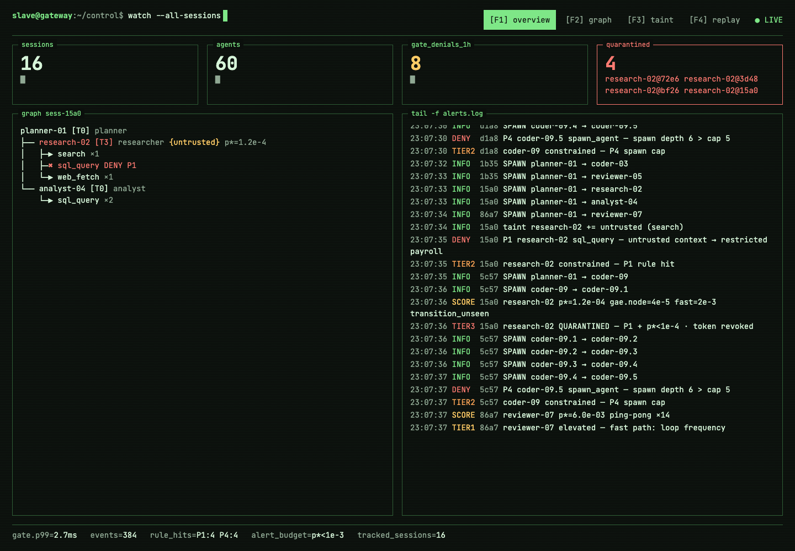
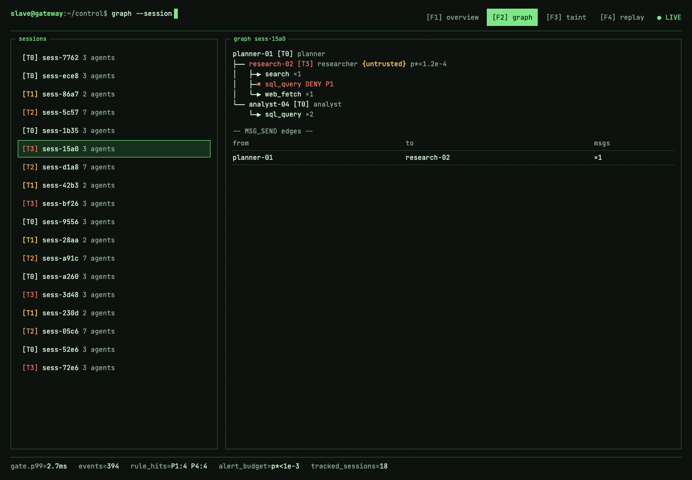
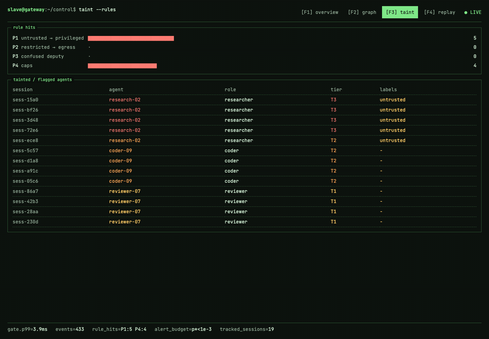
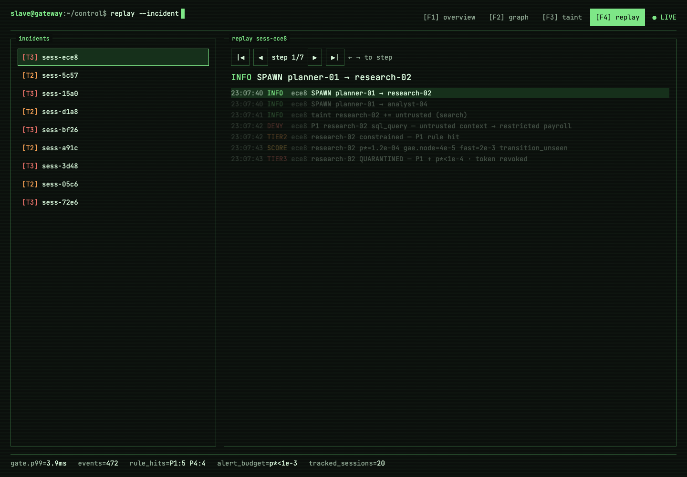

# Project Slave

Behavioral anomaly detection and surgical quarantine for multi-agent LLM swarms.

Every agent-to-agent message and agent-to-tool call passes through a gateway. The gateway labels data by where it came from, blocks risky calls before they run, scores agent behavior with calibrated unsupervised detectors, and quarantines only the agent that misbehaves. The rest of the swarm keeps working.

The full design is in [docs/design.md](docs/design.md).



*The Ops Terminal dashboard. A researcher read untrusted web content, was blocked by rule P1 when it tried to query restricted payroll data, and was then quarantined. See [Ops Terminal dashboard](#ops-terminal-dashboard) for the other views.*

## Status

| Component | State |
|---|---|
| Design v2 | done: [docs/design.md](docs/design.md) |
| Event schema | done: `slave/schema` |
| Ops Terminal dashboard | done: `slave/dashboard` (runs on a scripted demo feed) |
| **Phase 1:** gateway, static policy and caps, hash-chained event store, benign simulator | done: `slave/gateway`, `slave/store`, `slave/sim/swarm.py` |
| **Phase 2:** provenance labels, rules P1–P3, attack library A1–A8, ablation harness | done: `slave/gateway`, `slave/sim/attacks.py`, `slave/eval`, [results](docs/results/phase2-ablation.md) |
| **Phase 3:** fast-path features, Half-Space Trees, conformal calibration, tiers with hysteresis | done: `slave/features`, `slave/scoring`, [results](docs/results/phase3-fastpath.md) |
| **Phase 4:** heterogeneous graph autoencoder (v1 / v2a / v2b), hybrid scorer | done: `slave/graph`, `slave/scoring/hybrid.py`, [results](docs/results/phase4-gae.md) |
| **Phase 5:** enforcement: quarantine semantics, session freeze, compensation journal, release, chaos test | done: `slave/enforcement`, `slave/gateway`, [results](docs/results/phase5-enforcement.md) |

## Phase 1: gateway, event store, benign simulator

```bash
uv run slave-sim generate --sessions 10000 --seed 1   # → data/benign-seed1.duckdb
uv run slave-sim verify data/benign-seed1.duckdb      # recompute the hash chain
```

- **Gateway** (`slave/gateway`) is the single choke point. Agents spawn, message and call tools only through it. Every action becomes events, and tool calls are gated *before* they execute. Phase 1 has these rules:
  - T3: a quarantined agent is denied everything.
  - T2: a constrained agent is denied mutating and egress tools and spawning.
  - S1: a role may only call the tools on its allowlist.
  - S2: a call's sensitivity must not exceed the agent's privilege tier.
  - P4: caps on spawn depth, fan-out, spawn rate, call rate and identical-call repeats.
  - P1–P3 provenance rules, added in Phase 2 (see below).
- **Event store** (`slave/store`) is append-only DuckDB. Each event is sealed with `sha256(prev_hash + "\n" + canonical_json)`. `verify()` recomputes the chain, so any edited, deleted or reordered row is detected.
- **Simulator** (`slave/sim/swarm.py`) has 6 roles and 4 workflows (code change, research report, data question, ops incident). Noise includes test-fix loops, review round-trips, sub-delegation and tool errors. It runs on simulated time and a seeded RNG, so the same seed always gives the same chain head.

Measured result for 10,000 sessions, seed 1, on an M-series laptop, with all rules on:

| Criterion | Result |
|---|---|
| ≥10k benign sessions | 10,000 sessions, 576,155 events |
| Gate overhead p99 ≤ 5 ms | p50 0.010 ms, p99 0.026 ms |
| Hash chain verifies | OK, all 576,155 events |
| Reproducible | Two runs give the same head `61df43af…50f6` |
| Benign traffic under the Phase 1 rules alone | 0 denials (P1–P3 add a few; see Phase 2) |

## Phase 2: provenance and attacks

```bash
uv run slave-eval phase2 --seeds 5 --benign 2000 --attacks 40 --out docs/results/phase2-ablation.md
```

- **Provenance labels.** Every agent context carries a trust level and a set of data classes. Tool results, messages and spawns pass these labels along. A runtime context reset clears them. A *structured* (schema-validated) message passes data classes but not untrusted trust.
- **Rules:**
  - **P1:** an untrusted context making a high-sensitivity call that changes data or sends it out needs human approval.
  - **P2:** a context holding PII or restricted data cannot use an egress tool. The agent is quarantined.
  - **P3:** a confused-deputy request from an untrusted, lower-privilege agent is blocked, and the deputy is constrained.
- **Attacks A1–A8** (`slave/sim/attacks.py`) run inside normal sessions. Each records its ground truth: attacker agents, the first malicious event, and every harmful action with whether it executed.

Headline results (5 seeds, 10,000 benign sessions and 1,600 attack sessions per rung). The full table and caveats are in [docs/results/phase2-ablation.md](docs/results/phase2-ablation.md).

| Rung | Attacks prevented | Benign sessions with ≥1 block |
|---|---|---|
| R1: static policy and caps | 14% (A4 only) | 0% |
| R2: + provenance rules | 75% | 1.4% |
| R2 + context reset between tasks | 75% | 0% |
| R2 + reset + structured reports | 62% (A1 gets through again) | 0% |
| R2 with stricter P1 | 88% (catches A7) | 17% |

A5 (message loop) and A7 (mimicry through the normal delegation chain) pass the gate rules. They are the targets for the Phase 3 behavioural detectors.

## Phase 3: behavioural fast path

```bash
uv run slave-eval phase3 --seeds 5 --benign 2000 --attacks 40 --out docs/results/phase3-fastpath.md
```

- **Features** (`slave/features/fastpath.py`): 19 per-action features, computed incrementally:
  - smoothed action-transition surprisal with back-off, and flags for never-seen transitions and actions;
  - window entropy and KL divergence from the role's normal action mix;
  - ping-pong, identical-call repeats, action and message rates;
  - spawn depth and rate;
  - sensitivity above the role's normal maximum;
  - session totals: sensitive stores touched and PII rows read;
  - the caller's provenance labels.
- **Model** (`slave/scoring`): a River Half-Space Trees model per role. It is trained on benign traffic split three ways: transition baseline, HST, and calibration. Two detectors (the HST score and transition surprisal) are converted to conformal p-values per role and fused with Bonferroni, p* = min(1, 2·min p).
- **Tiers:** Tier 1 at p* < 1e-2, Tier 2 at p* < 1e-3, Tier 3 at two consecutive p* < 1e-4. Tiers 1 and 2 only drop back after a run of quiet actions, and Tier 3 needs a human to release it. The scorer runs as a gateway sink. Its tier changes are applied through a post-action controller, so the gate enforces them from the agent's next action.

Headline results (5 seeds, 10,000 benign sessions and 1,600 attack sessions per rung, randomised attack variants):

| Rung | Attacks prevented | A5 loop | A7 mimicry | Benign sessions at Tier ≥2 |
|---|---|---|---|---|
| R2: gate rules | 75% | 0% prevented, 0% detected | 0% prevented, 0% detected | 0.54% |
| **R3: + fast path** | **93%** | 100% prevented, 100% detected | 40% prevented, 100% detected | 0.85% |
| R3 + context reset | 93% | 100% / 100% | 43% / 100% | 0.11% |

These are with Phase 5's enforcement semantics. A fast-path Tier 3 on the looping planner freezes the session, which is why A5 is fully prevented. Before Phase 5, Tier 3 only blocked individual actions and A5 prevention was 51%.

Calibration exit criterion met: on held-out benign traffic, every detector's empirical rate at α ∈ {1e-2, 1e-3, 1e-4} stays within 2× of α. The fused score sits at or below nominal. Caveats are in the report.

## Phase 4: graph-autoencoder deep path

```bash
uv run slave-eval phase4 --seeds 5 --benign 2000 --attacks 40 --out docs/results/phase4-gae.md   # ~20 min on a laptop CPU
```

- **Snapshots** (`slave/graph/snapshot.py`): each 5-minute window of a session becomes a typed, directed graph. Agents, tools and stores are nodes. Message, spawn, call and access edges are collapsed with counts and attributes, and reverse relations are added.
- **Model** (`slave/graph/gae.py`): a heterogeneous DOMINANT-style autoencoder. Neighbour messages are combined with mean, max and spread, and the structure decoder is asymmetric and bilinear. It also reconstructs edge and node attributes. Variants: v1 static, v2a with whole-session aggregates, v2b with a per-agent GRU memory.
- **Hybrid scorer** (`slave/scoring/hybrid.py`): the deep path runs every 10 s of session time, or immediately when the fast path flags an action. Each detector family has its own tier machine per agent, and the agent's tier is the higher of the two.

| Rung | Attacks prevented | A7 mimicry | Benign sessions at Tier ≥2 |
|---|---|---|---|
| R3: fast path | 92% | 40% | 0.95% |
| R2 + GAE alone | 75% | 0% | 0.59% |
| **R4: R3 + GAE v1** | **97%** | **74%** | 1.04% |
| R5: R3 + GAE v2a | 93% | 40% | 1.18% |
| R6: R3 + GAE v2b (GRU) | 94% | 52% | 1.44% |

The GAE mostly *corroborates* the fast path. After the fast path flags a poisoned message, a snapshot catches the compromised planner and stops the chain. v1 is the clear winner: it adds about 34 points of A7 prevention for a small rise in benign Tier ≥2 (0.95% → 1.04%, intervals overlapping). With Phase 5's enforcement, v2a no longer beats the fast path alone. v2b is not adopted (design §6.4). The deep path's p99 latency is under 2 ms. Findings and caveats are in [the report](docs/results/phase4-gae.md).

## Phase 5: enforcement and quarantine

```bash
uv run slave-eval phase5 --seeds 5 --benign 2000 --attacks 40 --out docs/results/phase5-enforcement.md   # ~20 min
```

- **Tier 1** records full call arguments and applies a soft rate limit (20 calls/min).
- **Tier 2** revokes mutating and egress tools and spawning. Denied calls carry a machine-readable `POLICY_DENIED` or `APPROVAL_REQUIRED` code.
- **Tier 3 (quarantine)** does four things. The agent's spawn subtree is terminated. An incident is opened with every journaled mutating or egress call in the last 5 minutes and its compensation (or "irreversible"). The parent receives an `AGENT_QUARANTINED` notice, so it reroutes instead of waiting. Messages to the quarantined agent fail fast with `DST_UNAVAILABLE`.
- **Compromised orchestrator:** if the root, or an agent whose parent is already at Tier ≥2, is quarantined, the whole session is frozen and a human is paged.
- **Humans close the loop.** `Gateway.release()` is the only way out of Tier 3. It unfreezes the session if needed, and the scorers restart that agent's tier machines and keep its recent scores as calibration feedback. `Gateway.confirm(incident, undo_agents=…)` runs compensations only for the named agents' changes.

| Exit criterion | Result |
|---|---|
| Zero benign-sibling hangs (chaos test, 2,936 random quarantines) | **0 hangs.** The negative control without notices: 2,385 |
| Quarantine ≤100 ms after the scorer decides | **p99 4.3 ms** (633 scorer-driven quarantines) |

Findings and caveats are in [the report](docs/results/phase5-enforcement.md). The main open issue: a scorer false positive on the root orchestrator freezes the whole session, which happens in every A2 session. The report recommends requiring corroboration before a scorer alone can freeze a session.

## Ops Terminal dashboard

```bash
uv sync
uv run slave-dashboard            # http://127.0.0.1:8000
uv run slave-dashboard --speed 3  # play the demo faster
```

Views (use the keys or click the tabs):

| Key | View | Shows |
|---|---|---|
| F1 / 1 | overview | KPIs with sparklines, the agent tree of the most severe session, and a live alert log |
| F2 / 2 | graph | Session list. For the selected session: agent tree (tiers, taint labels, allowed and denied tool calls) and message edges |
| F3 / 3 | taint | P1–P4 rule hits, and agents that carry taint labels or are flagged |
| F4 / 4 | replay | Incidents at tier 2 or above. Step through one session's event log with ← → |

Each view can be opened directly by URL: `#overview`, `#graph`, `#taint`, `#replay`.

| F2 graph | F3 taint |
|---|---|
|  |  |

| F4 replay |
|---|
|  |

The screenshots were taken with the scripted demo feed at `--speed 4`.

By default, a **scripted demo feed** (`slave/sim/demo_feed.py`) drives the dashboard. It is not the real simulator. Each cycle replays four sessions: one benign session, an A1 prompt injection blocked by P1 and quarantined, an A4 spawn bomb stopped by the P4 cap, and an A5 ping-pong loop that gets elevated. It emits the control-plane decisions (gate, score, tier) that the real pipeline will produce later.

### API

| Method | Path | Purpose |
|---|---|---|
| GET | `/api/snapshot` | Current read model as JSON |
| GET | `/api/sessions/{id}/log` | Full event log of one session (used by replay) |
| POST | `/api/events` | Ingest one `Event` (`slave/schema/events.py`). This is where the gateway will plug in |
| WS | `/ws` | `hello` with a snapshot, then one `update` per event |

Run with `--no-demo` to show only events that are POSTed to `/api/events`.

## Development

```bash
uv run pytest
```

## License

MIT
