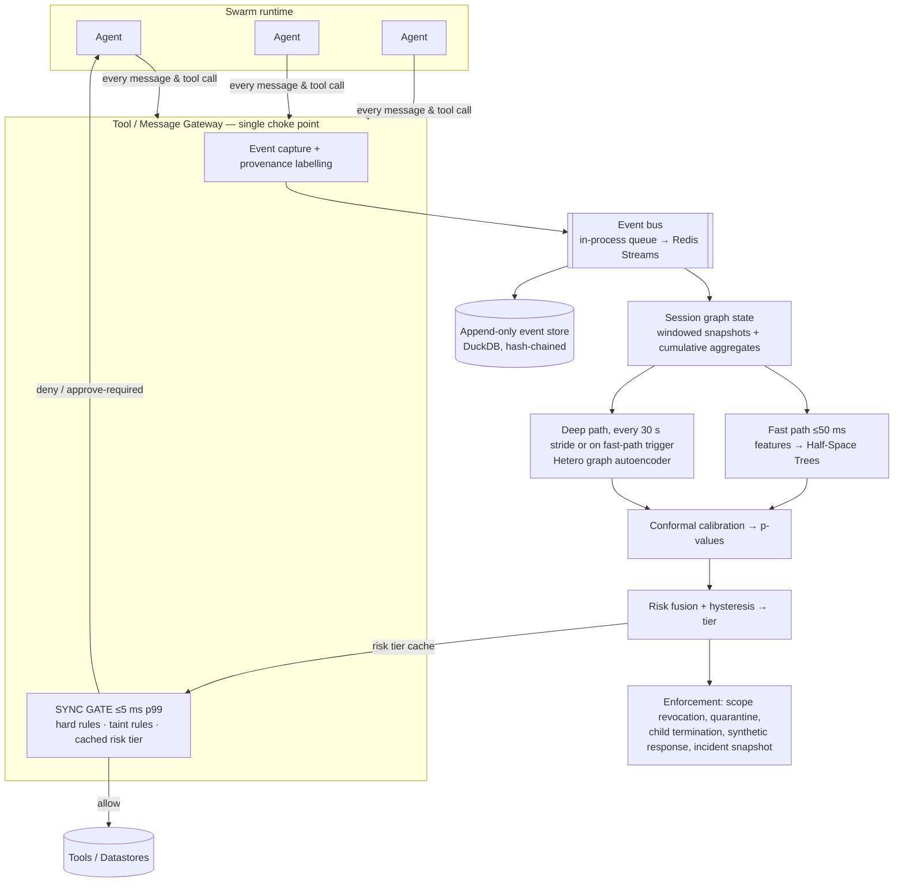
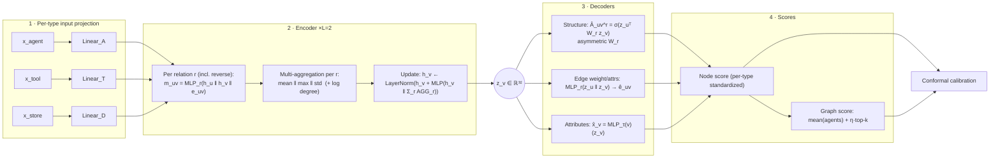

# Project Slave — Behavioral Anomaly Detection & Surgical Quarantine for Multi-Agent Swarms

**Status:** Design v2 (consolidated, supersedes the Gemini draft) · **Date:** 2026-11-25

Project Slave watches every agent-to-agent and agent-to-tool interaction in an LLM agent swarm, models each session as a typed directed graph, scores behavior with calibrated unsupervised detectors plus information-flow (provenance) rules, and isolates only the misbehaving agent while the rest of the swarm keeps working.

---

## 0. Working assumptions

These defaults are used throughout. Change any of them and the affected sections are flagged.

| Decision | Default chosen | Why |
|---|---|---|
| Scope | Capstone-scale reference implementation; every layer behind an interface so it can be swapped for Kafka/Flink/Triton at scale | Buildable in 16 weeks and evaluable end to end |
| Agent runtime | Custom Python swarm simulator speaking an MCP-style tool protocol; optional LLM-driven agents (Claude) for realism runs | Deterministic, cheap, reproducible traces with ground-truth attack labels |
| Language | Python 3.12 throughout | PyG, River, FastAPI all native |
| Core contributions | (1) Provenance/taint-aware gating, (2) heterogeneous graph autoencoder with calibrated fusion, (3) ablation showing what each layer buys | Gives a research result, not just integration |

---

## 1. Threat model

**Assets:** restricted datastores (PII, HR, finance), mutating tools (write, commit, deploy), egress channels (email, HTTP POST), credentials held by the gateway.

**Adversary capabilities (in scope):**

| ID | Attack | Example |
|---|---|---|
| A1 | Indirect prompt injection → lateral movement | `web_fetch` returns a page instructing the researcher to query payroll and POST it out |
| A2 | Confused deputy | Low-privilege agent asks a high-privilege agent to run a restricted query on its behalf |
| A3 | Collusive split exfiltration | Three agents each read 1/3 of a restricted table, each under per-agent limits |
| A4 | Runaway recursion / spawn bomb | Agent recursively spawns sub-agents |
| A5 | Ping-pong / feedback loop | Two agents bounce the same request indefinitely, burning budget |
| A6 | Slow-burn | A1/A3 spread across hours to evade short windows |
| A7 | Mimicry | Attack built only from tool transitions seen in benign baselines |
| A8 | Compromised orchestrator | The root planner itself is injected |

**Out of scope:** compromise of the gateway host, model-weight backdoors, attacks that never touch a tool or another agent (pure text harm).

**Security invariants the system must keep:**
1. No agent holds tool credentials. Every tool call passes through the gateway — telemetry cannot be skipped by a compromised agent.
2. A mutating/egress call is never executed before the synchronous gate approves it.
3. A hard-policy violation always reaches Tier 3, regardless of model scores.

---

## 2. Architecture



### 2.1 Why two enforcement paths

The Gemini draft promised both "monitoring never blocks" and "quarantine before damage" — contradictory when detection is asynchronous (the harmful call has already run 250 ms later).

* **Synchronous gate (inline, ≤5 ms p99):** runs on every tool call *before* execution. Uses only cheap deterministic inputs: static policy, provenance/taint labels, rate/depth caps, and the agent's **cached** risk tier from the async scorer.
* **Asynchronous scoring (off the critical path):** updates the risk tier that the gate consults on the agent's *next* action.

**Staleness rule:** if an agent's cached tier is older than 10 s and the call is `mutating` or `external_egress`, the gate fails *closed* (deny + retry hint); `read_only` calls fail *open*.

### 2.2 Latency budget (targets, to be measured — not claims)

| Stage | Target |
|---|---|
| Gateway capture + sync gate | ≤5 ms p99 |
| Fast path, per event | ≤50 ms p99 (async) |
| Deep path, per snapshot | ≤150 ms p99 (async); detection delay ≤ stride (30 s) |
| Risk tier → enforcement | ≤100 ms after scoring |

The deep path is **not** sub-second end to end, by design. Immediate threats are the gate's and fast path's job; the GAE catches structural anomalies the rules can't express.

---

## 3. Event schema & provenance

### 3.1 Event (Pydantic model, one per gateway interaction)

```text
event_id, session_id, ts, kind ∈ {MSG_SEND, TOOL_CALL, TOOL_RESULT, DATA_ACCESS, SPAWN, TERMINATE}
src_id, src_type, dst_id, dst_type
agent: role_class, privilege_tier (0–4), parent_id, spawn_depth, prompt_version
tool:  tool_id, side_effect ∈ {read_only, mutating, external_egress}, sensitivity (0–4)
data:  resource_uri, classification ∈ {public, internal, pii, restricted}, op, row_volume
payload_meta: token_count, bytes, latency_ms, status, arg_schema_id
labels: trust ∈ {system, internal, untrusted}, data_classes ⊆ {pii, restricted, …}
prev_hash, hash        # hash chain for tamper evidence
```

Raw payloads are **not** stored by default (only metadata + labels); full capture is enabled per agent at Tier ≥1.

### 3.2 Provenance / taint tracking (core contribution #1)

Prompt injection enters through *content*. Graph topology alone can't see "this agent just read an untrusted web page"; provenance labels can.

**Sources (label assignment at the gateway):**
* `web_fetch`, `search`, inbound email, user-uploaded files → `trust = untrusted`
* Internal repos / internal DB → `trust = internal`, plus `data_classes` from the datastore classification
* Orchestrator system instructions → `trust = system`

**Propagation:** each agent carries a context label `L(agent) = (min_trust, ∪ data_classes)` = the join of labels of everything that entered its context since its last context reset.
* `TOOL_RESULT` → caller: `L(caller) ⊔= labels(result)`
* `MSG_SEND u→v`: `L(v) ⊔= L(u)`
* `SPAWN u→v`: `L(v) := L(u)` (child inherits)
* Declassification only via explicitly registered sanitizer tools (e.g. a summarizer that returns a schema-validated, non-free-text output).

**Gate rules (deterministic, explainable):**

| Rule | Condition | Action |
|---|---|---|
| P1 Injection → privileged action | `min_trust = untrusted` ∧ tool is `mutating`/`external_egress` ∧ `sensitivity ≥ 3` | Require human approval (Tier 2 for that call) |
| P2 Exfiltration | `{pii, restricted} ∩ data_classes ≠ ∅` ∧ tool is `external_egress` | Deny + Tier 3 |
| P3 Confused deputy | `MSG_SEND` or `SPAWN u→v` where `u`'s context is **untrusted** and `privilege(u) < privilege(v)`, followed within 10 min by `v` accessing a resource with sensitivity above `privilege(u)` | Deny that access; Tier 2 for `v` |
| P4 Caps | spawn depth > D, spawn rate > S/min, identical (tool, args) repeat > K | Deny; Tier 2 |

**Phase 2 refinement of P3:** the rule only counts requests whose sender context is untrusted. If it counted every lower-privilege request, a planner (privilege 2) delegating a restart to ops (privilege 3) would be blocked, and that is ordinary delegation.

**Measured (Phase 2):** see [results/phase2-ablation.md](results/phase2-ablation.md). Adding P1–P3 raises prevention across A1–A8 from 12% to 75%. 1.3% of benign sessions see at least one block, and a context reset between tasks removes all of those blocks in the simulator.

**Measured (Phase 3):** see [results/phase3-fastpath.md](results/phase3-fastpath.md). The behavioural fast path raises prevention from 75% to 87% and detects A5 and A7, which no gate rule catches. Calibration holds within 2× of nominal. With p* = 2·min p, a role needs more than about 20,000 calibration scores before the fast path alone can reach Tier 3.

**Measured (Phase 4):** see [results/phase4-gae.md](results/phase4-gae.md). Adding GAE v1 raises prevention to 90% (A7: 44% → 73%) by corroborating fast-path flags, at about twice the benign Tier ≥2 rate. v2a is the balanced option (88%). v2b (GRU) is not adopted: it doesn't beat v2a on A6. Two implementation decisions came out of this phase. The snapshot stride is scaled to 10 s for simulated sessions. Each detector family (fast, deep) keeps its own tier machine per agent, and the agent tier is the max. With one shared machine, routine scores from one family reset the other's Tier 3 streak.

**Known limitation — label creep:** conservative propagation over-taints long sessions. We measure an **over-taint rate** (benign calls blocked by P1–P3) as a first-class metric and evaluate two mitigations: per-agent context resets on task boundaries, and sanitizer declassification.

---

## 4. Graph model

Each session is a typed, directed multigraph. Snapshots `G_t` cover a 5-minute window with 30-second stride; multiple interactions between the same pair in a window are collapsed into **one edge with count and aggregated attributes** (counts are kept — 1 call vs. 400 is the signal).

| Node type | Features (all numeric, standardized) |
|---|---|
| Agent | role one-hot, privilege tier, spawn depth, log in/out degree per relation, taint flags (untrusted, pii, restricted), window summary of fast-path features |
| Tool | side-effect one-hot, sensitivity, log call count, error rate, log mean latency |
| DataStore | classification one-hot, log rows read, log rows written, op mix |

| Relation (direction preserved) | Edge attributes `e_uv` |
|---|---|
| Agent –MSG_SEND→ Agent | log1p count, log1p mean tokens, first/last time in window ∈ [0,1] |
| Agent –SPAWN→ Agent | depth, first time in window |
| Agent –TOOL_CALL→ Tool | log1p count, error rate, log1p mean latency, `schema_is_new` flag, payload trust level, first/last time |
| Tool –DATA_ACCESS→ DataStore | log1p rows, op one-hot, first/last time |

Rules for edge features: heavy-tailed counts/latencies go through `log1p` then robust standardization; hashes (`arg_schema_hash`) are **never** fed as numbers — they become a `schema_is_new` flag (v1) or a learned embedding with an `<unseen>` bucket (v2). First/last relative timestamps keep some ordering information that a static snapshot would otherwise lose.

For message passing, every relation gets an explicit **reverse relation** (`rev_TOOL_CALL`, etc.) as a separate edge type, so information flows both ways while direction stays distinguishable.

---

## 5. Fast path (per event, async)

Computed incrementally per `(session, agent)`; plain Python state objects in v1.

| Family | Features | Fixes vs. Gemini draft |
|---|---|---|
| Tool transitions | Smoothed surprisal $S = -\log \hat P(T_t \mid T_{t-1}, \text{role})$ with $\hat P = \frac{c(i\to j)+\alpha}{c(i)+\alpha\lvert T\rvert}$, backing off to the role-agnostic model when $c(i) < 20$; capped at $S_{\max}$; separate binary `transition_unseen` | Unsmoothed matrix made every novel transition "infinite" |
| Behavior distribution | Entropy of tool-category distribution in window; KL vs. role baseline (smoothed) | Dropped the undefined 64-d message embedding and `intent_hash` from v1 (no model in hot path, no content retention) |
| Loops & recursion | A→B→A ping-pong count, identical (tool, args) repeats, SCC fraction (NetworkX on the window graph), spawn depth & rate | — |
| Privilege | max `privilege_delta`, `unseen_role_zone_edge` flag | — |
| Session cumulative | distinct sensitive resources touched, total restricted rows read, total egress bytes, distinct tools used | Collusion/slow-burn are aggregate signals, not GAE signals |
| Provenance | current taint flags, count of P1–P3 near-misses | New |

**Model:** River `HalfSpaceTrees` per role group (trained on benign streams, frozen at evaluation), fed log-transformed, standardized features. Output → calibration (§7).

---

## 6. Deep path: Heterogeneous graph autoencoder (core contribution #2)



### 6.1 Encoder

$$h_v^{(0)} = \mathrm{ReLU}(W_{\tau(v)} x_v + b_{\tau(v)})$$

For each relation $r$ (forward and reverse), an edge-conditioned message:

$$m^{(r,l)}_{u\to v} = \mathrm{MLP}_r\big(h_u^{(l)} \,\Vert\, h_v^{(l)} \,\Vert\, e_{uv}\big)$$

**Aggregation — why not attention or sum.** Softmax attention normalizes weights to 1, so one malicious edge into a 100-edge hub gets ~1% weight; trained only on benign data, attention has no reason to focus on it. Sum lets hubs dominate. We use **multi-aggregation** (mean ‖ max ‖ std, PNA-style, via PyG `MultiAggregation`): mean is degree-robust, **max preserves single outlier edges**, std captures dispersion; log-degree is appended so volume stays visible.

$$a_v^{(r,l)} = \big[\mathrm{mean}\,\Vert\,\max\,\Vert\,\mathrm{std}\big]_{u\in\mathcal N_r(v)} m^{(r,l)}_{u\to v} \;\Vert\; \log(1+\deg_r(v))$$

**Update with residual** (keeps the node's own state; required because bipartite relations have no self-loops):

$$h_v^{(l+1)} = \mathrm{LayerNorm}\Big(h_v^{(l)} + \mathrm{MLP}\big(h_v^{(l)} \,\Vert\, \textstyle\sum_{r} a_v^{(r,l)}\big)\Big)$$

Implementation: a custom `MessagePassing` subclass (`EdgeMLPConv`, `aggr=MultiAggregation([...])`) wrapped in `HeteroConv(aggr="sum")`. $L=2$, hidden 64, latent $z_v \in \mathbb R^{32}$, dropout 0.2. The small bottleneck + dropout counter DOMINANT's known failure mode of learning to reconstruct anomalies too.

### 6.2 Decoders & training loss

* **Structure (existence):** $\hat A^{(r)}_{uv} = \sigma(z_u^\top W_r z_v)$, asymmetric $W_r$. Trained with BCE on observed edges + **negative sampling** (5 negatives per positive, restricted to type-valid pairs), so the loss isn't dominated by the sea of zeros.
* **Edge weight/attributes:** $\hat e_{uv} = \mathrm{MLP}_r(z_u \Vert z_v)$ predicts log1p count and edge attributes on observed edges (MSE). This is what makes "400 calls instead of 1" visible.
* **Attributes:** $\hat x_v = \mathrm{MLP}_{\tau(v)}(z_v)$, MSE.

$$\mathcal L = \mathcal L_{\text{attr}} + \mu_1 \mathcal L_{\text{struct}} + \mu_2 \mathcal L_{\text{edge}}$$

Trained only on benign training snapshots; early-stopped on benign validation loss.

### 6.3 Scores (size- and type-normalized)

Per node $v$ of type $\tau$:

$$\epsilon^{\text{attr}}_v = \tfrac{1}{d_\tau}\lVert x_v-\hat x_v\rVert_2^2,\qquad
\epsilon^{\text{struct}}_v = \tfrac{1}{\lvert \mathcal E_v\rvert}\sum_{(u,v,r)\in\mathcal E_v}\Big[\mathrm{BCE}(\hat A^{(r)}_{uv},1) + \lVert e_{uv}-\hat e_{uv}\rVert^2\Big] + \tfrac{1}{\lvert \mathcal N^-_v\rvert}\sum_{\text{neg}}\mathrm{BCE}(\hat A,0)$$

Averaging over incident edges and sampled non-edges removes the dependence on graph size. Each error is then **robust-standardized per node type** using median/MAD from the benign calibration set, giving $\tilde\epsilon$, and

$$s(v) = \lambda\,\tilde\epsilon^{\text{attr}}_v + (1-\lambda)\,\tilde\epsilon^{\text{struct}}_v, \qquad
s(G_t) = \operatorname{mean}_{v\in\text{agents}} s(v) + \eta\cdot\operatorname{TopKMean}_{k=\min(3,\lvert V\rvert)} s(v)$$

$\lambda$ and $\eta$ are tuned on the **dev** attack set only (never on test).

### 6.4 Temporal ablation (v2)

| Variant | What it adds | Compared against |
|---|---|---|
| v1 Static windowed | §6.1–6.3 | — |
| v2a Session aggregates | §5 cumulative features appended to agent node features | v1 |
| v2b Recurrent | per-node GRU memory $s_v(t)=\mathrm{GRU}(s_v(t-1), z_v(t))$ before decoding | v2a |

v2b is adopted only if it beats v2a on A6 (slow-burn) recall at fixed FPR with non-overlapping 95% bootstrap CIs, within the 150 ms budget. The cheap aggregates may well be enough.

---

## 7. Calibration & risk fusion

Raw scores (HST score, node error, graph error) live on incompatible scales; adding them with fixed weights and thresholds (0.60/0.75/0.88) is meaningless. Instead:

**Conformal p-values.** For each detector $d$ and stratum (role group for node scores; graph-size bucket for graph scores), keep a benign calibration set $\{s_1..s_n\}$:

$$p_d = \frac{1 + \#\{i: s_i \ge s\}}{n+1}$$

Under the benign distribution $p_d$ is (super-)uniform, so a threshold of $p < 10^{-3}$ means ~1 false alert per 1,000 scored agent-windows — a directly interpretable alert budget.

**Fusion.** The detectors are correlated, so Fisher's method (which assumes independence) is invalid. Use Bonferroni-adjusted min-p, valid under any dependence:

$$p^\star(v,t) = \min\big(1,\; m\cdot\min_d p_d(v,t)\big)$$

where $m$ = number of detectors (3). The graph-level p-value is attributed to the top-k contributing agents.

**Tiers (with hysteresis):**

| Tier | Entry condition | Exit |
|---|---|---|
| 0 Normal | — | — |
| 1 Elevated | $p^\star < 10^{-2}$ | 3 consecutive windows with $p^\star \ge 10^{-2}$ |
| 2 Constrained | $p^\star < 10^{-3}$, **or** P1/P3/P4 rule hit | 5 quiet windows + no rule hits |
| 3 Quarantine | $p^\star < 10^{-4}$ in 2 consecutive scorings, **or** P2 / any hard-policy violation (immediate override) | Human release only |

Thresholds are starting points; the ablation reports the full ROC so they can be re-chosen to an alert budget.

---

## 8. Enforcement & quarantine semantics

| Tier | Action at gateway | Swarm continuity |
|---|---|---|
| 1 | Full payload capture for this agent, SOC warning, soft rate limit | Unaffected |
| 2 | Mutating/egress scopes revoked; those calls return `403 POLICY_DENIED` with a machine-readable reason | Agent can keep reasoning and reading |
| 3 | All calls from $v$ denied; short-lived token revoked; descendants (SPAWN subtree) terminated; incident snapshot written; parent receives synthetic `AGENT_QUARANTINED{agent, reason, safe_to_retry}` | Parent reroutes or escalates |

**Edge cases the draft missed:**
* **Compromised orchestrator (A8):** if $v$ is the session root, or $v$'s parent is itself at Tier ≥2, there is no trustworthy parent to notify → **freeze the whole session** and page a human.
* **Actions already executed:** the gateway journals every mutating call. Tools may register a compensating action (e.g. `git revert`, soft-delete restore); on quarantine, compensations for $v$'s calls in the last window are proposed (human-confirmed). Non-reversible actions (sent email) are listed explicitly in the incident.
* **False-positive recovery:** a `release` endpoint lets a reviewer restore an agent; the released windows, once reviewed, are added to the calibration set (not the training set) so the same benign pattern stops alerting.

---

## 9. Securing the monitor itself

| Risk | Mitigation |
|---|---|
| Agent suppresses its own telemetry | Capture happens at the gateway, which holds all credentials; SDK/OTel spans are optional enrichment only, and SDK-vs-gateway discrepancies are themselves an anomaly signal |
| Event log tampering | Append-only store, hash-chained events; chain verified before forensics |
| Baseline poisoning (slow attacker trains the model to accept them) | Retraining uses only windows with no alerts *and* a human-reviewed sample; every candidate model must pass the full attack regression suite (no recall drop beyond tolerance) before promotion; versioned rollback |
| Mimicry (A7) | Explicitly in the evaluation set; provenance rules don't depend on statistical normality, so they cover what mimicry evades |
| Privacy | Metadata-only by default; payloads only at Tier ≥1, with retention limits; PII never leaves the event store to dashboards unredacted |

**Concept drift:** model + calibration sets are versioned by `(prompt_version, tool_registry_version)`. When a new tool or prompt version ships, the affected role runs in shadow (scores logged, tiers capped at 1) until its calibration set holds ≥500 benign windows. New roles with no baseline inherit their parent role class's model with tiers capped at 1, and rely on provenance rules and caps (which need no baseline).

---

## 10. Data: swarm simulator & attack library

There are no "verified benign production traces" to start from, so the simulator is a first-class deliverable.

* **Roles:** planner (orchestrator), researcher, coder, reviewer, data_analyst, ops.
* **Tools:** `web_fetch`*, `search`*, `read_file`, `write_file`, `git_diff`, `git_commit`, `run_tests`, `sql_query` (internal), `hr_payroll_query` (restricted), `send_email`†, `http_post`†, `spawn_agent`. (*untrusted source, †egress)
* **Benign behavior:** stochastic task scripts per role (parametrized workflows: research → summarize, code → test → review → commit, analyze → report), with randomized durations, retries, errors, and occasional legitimate bursts and new-tool rollouts — so the FPR is measured against realistic noise, not a toy baseline.
* **LLM mode (optional):** the same roles driven by Claude via tool use, for a smaller realism validation set.
* **Attacks:** A1–A8 as injectable scenario modules with ground-truth labels: attacker agent(s), the first malicious event, and the "harm event" (the call that would cause damage).

---

## 11. Evaluation protocol

**Splits:** benign-train / benign-calibration / benign-test; attacks-dev (A1–A5 variants) / attacks-test (A1–A8, including held-out families A6–A8 never used for tuning).

**Metrics:**
* **Prevention rate:** attacks where Tier ≥2 was reached *before* the harm event executed (the number that matters).
* **Detection rate:** reached Tier ≥2 at any point; **time-to-detect** in events and seconds.
* **False alerts:** Tier ≥1 and Tier ≥2 per 1,000 benign sessions; per-agent-window FPR.
* **Collateral:** fraction of benign sibling agents disrupted during a quarantine.
* **Over-taint rate:** benign calls blocked by provenance rules.
* **Overhead:** gateway p50/p99 latency, scorer throughput.

**Ablation ladder** (the research result):

1. Caps + static policy only
2. \+ provenance rules
3. \+ fast path (HST)
4. \+ GAE v1
5. \+ session aggregates (v2a)
6. \+ GRU (v2b)

All results over ≥5 simulator seeds with 95% bootstrap CIs; ROC/PR curves reported, not just one operating point.

---

## 12. Technology stack

| Layer | v1 (this project) | Scale-out replacement |
|---|---|---|
| Gateway | FastAPI + asyncio, MCP-style JSON-RPC | Envoy filter / MCP proxy |
| Bus | In-process `asyncio.Queue` behind an `EventBus` interface; Redis Streams adapter | Kafka / Redpanda |
| Graph state | Python + NetworkX per session | Flink keyed state |
| Event store | DuckDB (append-only, hash-chained) | ClickHouse |
| Fast path | River `HalfSpaceTrees` | Same, inside Flink |
| Deep path | PyTorch + PyG, in-process (ONNX export optional) | Triton |
| Policy | Python rule engine in the gateway | OPA |
| Dashboard | "Ops Terminal" UI: FastAPI + WebSocket, plain HTML/CSS/JS (`slave/dashboard`) | SOC/SIEM integration |
| Tooling | uv, Pydantic v2, pytest, ruff, Docker Compose | — |

---

## 13. Phased plan (16 weeks)

| Phase | Weeks | Deliverables | Exit criteria |
|---|---|---|---|
| 1 Foundation | 1–3 | Event schema, gateway with capture + static policy + caps, event store, benign simulator (6 roles) | 10k benign sessions generated reproducibly; gateway overhead p99 ≤5 ms; hash chain verifies |
| 2 Provenance & attacks | 4–6 | Taint propagation, P1–P4 gate rules, attack modules A1–A8, metrics harness | Ablation rungs 1–2 reported; over-taint rate measured |
| 3 Fast path & calibration | 7–9 | Feature extractors, HST, conformal calibration, fusion, tiers with hysteresis | Rung 3 reported; empirical FPR within 2× of nominal on benign-test |
| 4 Graph autoencoder | 10–12 | Snapshot builder, hetero GAE, scoring, v2a/v2b ablations | Rungs 4–6 reported with CIs |
| 5 Enforcement | 13–14 | Tier actions, quarantine, subtree termination, synthetic responses, compensation journal, release flow, A8 session freeze | Chaos test: zero benign-sibling hangs; quarantine ≤100 ms after scoring |
| 6 Dashboard & report | 15–16 | Wire the Ops Terminal dashboard to the live event bus, forensics replay, final evaluation, write-up | Full results table + reproducibility script |

---

## 14. Repository layout

```text
slave/
  schema/        # Pydantic event & label models
  gateway/       # FastAPI proxy, sync gate, policy + provenance rules
  bus/           # EventBus interface, in-proc + Redis adapters
  store/         # DuckDB event store, hash chain
  graph/         # session state, windowed snapshot builder (→ PyG HeteroData)
  features/      # fast-path extractors
  models/        # HST wrapper, hetero GAE, training scripts
  scoring/       # conformal calibration, fusion, tiers
  enforcement/   # quarantine, compensation journal, release
  sim/           # swarm simulator, roles, tools, attacks A1–A8
  eval/          # metrics, ablation runner, reports
  dashboard/
tests/
docs/
```

---

## Appendix: Changes from the Gemini draft

| Gemini draft | Problem | Resolution (section) |
|---|---|---|
| Async detection, "never blocks" | Harm executes before quarantine | Sync gate + cached tier + fail-closed staleness rule (§2.1) |
| $R = \alpha\,IF + \beta\,L_{node} + \gamma\,L_{graph} + \delta\,\mathbb I$ with 0.60/0.75/0.88 | Incompatible scales; policy violation can be outweighed | Conformal p-values, Bonferroni min-p, hard-violation override (§7) |
| Prompt content ignored | Injection's entry point invisible | Provenance/taint labels + P1–P4 (§3.2) |
| Generic homogeneous GNN diagram | No decoder, no direction, no edge features | Hetero DOMINANT-style GAE (§6) |
| "Attention prevents hub drowning" | Softmax dilutes single outlier edges | Mean‖max‖std multi-aggregation + log degree (§6.1) |
| Update without self-state | Node's own state dropped | Residual MLP update + LayerNorm (§6.1) |
| $\lVert a_v-\hat a_v\rVert$ on binary adjacency | Dominated by non-edges; scales with graph size; loses counts | Negative-sampled BCE, edge-weight decoder, per-edge averaging (§6.2–6.3) |
| Raw `arg_schema_hash`, raw counts as features | Hash isn't numeric; heavy tails | `schema_is_new` flag / embedding; log1p + robust scaling (§4) |
| GAE targets ping-pong & transitions | Snapshots have no order | Moved to fast path; relative timestamps on edges (§4–5) |
| GRU only for slow-burn | No cheap baseline | Session aggregates (v2a) vs GRU (v2b) (§6.4) |
| Unsmoothed Markov surprisal | Novel transitions → ∞ | Additive smoothing + backoff + cap + unseen flag (§5) |
| 64-d message embedding, `intent_hash` | Undefined, model in hot path, privacy | Removed from v1 (§5) |
| "Verified benign traces" | No source | Simulator + attack library (§10) |
| 92% recall / 0.5% FPR | Unit undefined; alert flood | Prevention rate, per-session alerts, CIs, held-out attack families (§11) |
| Parent orchestrator always notified | Orchestrator may be the attacker | Session freeze + human (§8) |
| Auto weekly retraining | Baseline poisoning | Gated retraining + regression suite (§9) |
| SDK self-reported telemetry | Compromised agent goes silent | Gateway as sole credential holder (§1, §9) |
| 10+ enterprise systems in 16 weeks | Not finishable | Interface-first v1 stack (§12) |
